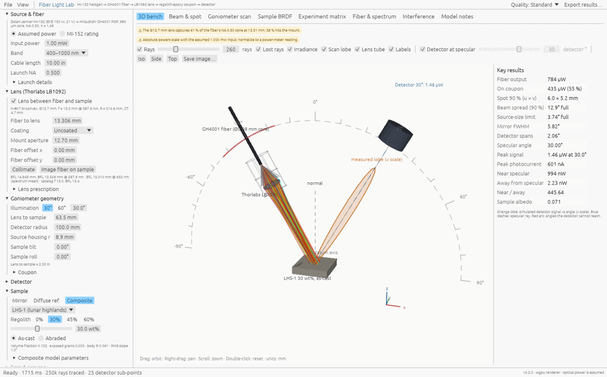
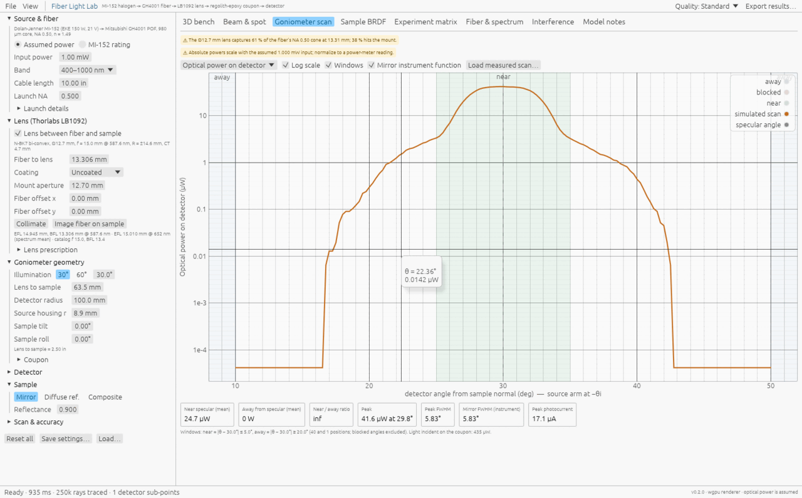
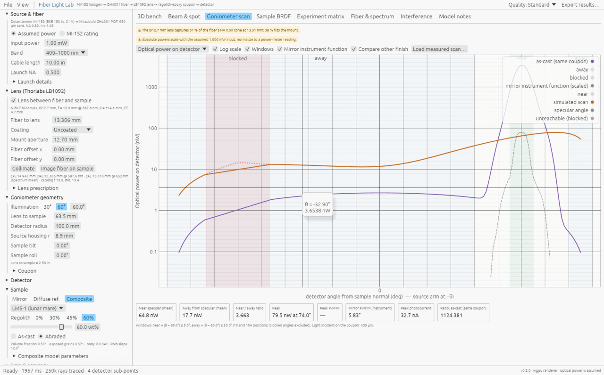

# Fiber Light Lab — native simulator

A single-file desktop program (Windows `.exe`, also builds on Linux/macOS) that ray-traces the
regolith goniometer bench:

**MI-152 halogen → GH4001 fiber (10 in) → Thorlabs LB1092 lens → regolith-epoxy coupon → detector**

It replaces the Python/Qt app as the main tool. It reproduces the Python fiber model exactly
and adds the lens, the goniometer, the coupon reflectance and the detector. There is nothing
to install: download `FiberLightLab.exe` from the repository's Releases page and run it.



## What you can do with it

| Tab | Shows |
|---|---|
| **3D bench** | Rotatable bench in true millimeters: fiber, LB1092 solid, rays colored by wavelength, coupon with the irradiance map, detector, goniometer arc, the zone blocked by the source arm, and the simulated reflection lobe. |
| **Beam & spot** | Irradiance on the coupon with its outline, beam diameter vs distance, angular spread after the lens, and the power budget (mount, lens surfaces, coupon). |
| **Goniometer scan** | Detector signal vs angle as power, photocurrent, amplifier voltage, power-meter reading or inferred BRDF. Shows the near/away windows and ratio, the mirror instrument function, a comparison with the other finish, and an overlay of your measured CSV. |
| **Sample BRDF** | The coupon model without instrument effects, split into resin surface, body, exposed grains and back face. |
| **Experiment matrix** | The planned study (0/30/45/60 wt% × as-cast/abraded × 30°/60°, LHS-1 and LMS-1). Reports near/away ratios and whether finishing or content dominates under the model's assumptions. |
| **Fiber & spectrum** | Same charts as the Python app: spectra, attenuation, power along the cable, temporal coherence. |
| **Interference** | The illustrative coherent vs halogen explorer from the Python app. With the lens, it uses the traced beam's angular spread. |
| **Model notes** | Equations, sources, verification and limitations ([MODEL_NATIVE.md](MODEL_NATIVE.md)). |

**File → Export results…** writes `settings.json`, `summary.json` and CSVs (scan, spectrum, beam
profile, sample irradiance, BRDF, experiment matrix). **Save/Load settings** stores a bench
configuration as JSON; drop a JSON onto the `.exe` to open it. **Save image…** on the 3D tab
saves a PNG.

| Mirror check (instrument function) | Abraded LMS-1 60 wt% at 60°, vs its as-cast twin |
|---|---|
|  |  |

## Suggested first use (from the research plan)

1. **Enter your bench**: lens-to-sample distance, detector arm radius, coupon size and the
   real detector. Load its responsivity CSV if you have one.
2. **Mirror check**: choose *Sample → Mirror*. The scan is the instrument function: its
   center gives alignment and its width gives angular resolution. Compare it with a real
   mirror scan using **Load measured scan…**. Use *Fiber offset* and *Sample tilt* to
   reproduce any shift you measure.
3. **Diffuse reference**: verify the cos θ fall-off and that the detector output is
   proportional over the signal range shown (about 1 nA to 20 µA per mW in the fiber).
4. **Pilot coupons**: switch to *Composite*, pick LHS-1 or LMS-1 and the loading, and toggle
   as-cast/abraded. Overlay the measured scans and adjust the model parameters.
5. **Experiment matrix**: run it to see the expected effect sizes and whether the windows
   (±5° near, >20° away) separate them with this instrument.

## Command-line runner

`fiberlab-cli` runs the same physics without a window (for batch runs or scripts):

```
fiberlab-cli --print-default-config > bench.json      # edit this file
fiberlab-cli --config bench.json --out results/       # summary + CSVs
fiberlab-cli --config bench.json --incidence 60 --study --out results60/
```

The desktop app also accepts `--settings bench.json`, `--tab scan` and `--glow` (force
OpenGL if DirectX/Vulkan is unavailable). You can also set `FIBERLAB_RENDERER=glow`.

## Build from source

Requires Rust 1.85+ (edition 2024).

```
cd fiber_light_lab/native
cargo build --release          # target/release/FiberLightLab(.exe) and fiberlab-cli
cargo test                     # physics, parity and pipeline tests
```

To cross-compile for Windows from Linux:
`rustup target add x86_64-pc-windows-gnu`, install `gcc-mingw-w64-x86-64`, then
`cargo build --release --target x86_64-pc-windows-gnu`.
Pushing a tag `fiber-light-lab-v*` builds the Windows release with GitHub Actions
(`.github/workflows/fiber-light-lab-release.yml`).

To regenerate the Python parity fixture:
`python verification/make_native_reference.py` (from `fiber_light_lab/`, with numpy/scipy).

## Layout

```
native/
  src/physics/   fiber.rs (Python port) · lens.rs · bench.rs (ray trace) · sample.rs (BRDFs)
                 goniometer.rs (detector, scan, metrics) · sim.rs (pipeline, study) · report.rs
                 wave.rs (coherence, interference) · math.rs · data.rs (embedded ../data CSVs)
  src/app/       egui desktop interface and the 3D renderer
  src/bin/       fiberlab_cli.rs
  tests/         parity_python.rs + fixtures/python_reference.json
```

The physics reads the same `fiber_light_lab/data/*.csv` files as the Python app; they are
compiled into the executable.
